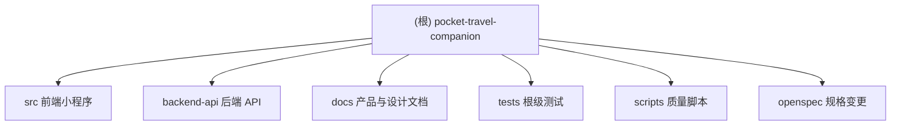

# 口袋旅行搭子 - Claude 项目上下文

## 变更记录 (Changelog)

- 2026-05-06T22:03:17+08:00：按阶段 A-D 续扫并更新项目上下文；识别新增 `tests/`、`scripts/`、`openspec/` 支撑模块，补扫前后端 Vitest 配置、业务规则测试、PRD 覆盖矩阵、OpenSpec 实施计划、后端 auth/mood/share/user 与微信/地图/RAG 占位服务。
- 2026-04-29T12:13:34+08:00：断点续扫项目上下文；补扫前端关键业务页面、豆子/GPS/请求工具、后端路线/景点/豆子 controller 与 model，更新覆盖率、缺口与索引。
- 2026-04-27T15:21:03+08:00：初始化项目级 Claude 上下文；完成全仓清点、前端与后端模块扫描，新增模块结构图、覆盖率与续扫缺口。

## 项目愿景

「口袋旅行搭子」是面向 18~35 岁年轻人的情绪疗愈型周末微旅行规划助手。产品通过情绪画像、AI 路线生成、NFC 实体唤起、打卡与豆子激励，形成“探索灵感 -> 生成规划 -> 现场打卡 -> 分享赚豆”的闭环。

核心业务目标：降低周末出行攻略成本，让路线推荐从“热门景点罗列”转向“情绪与场景匹配”。

## 架构总览

当前仓库是前后端同仓项目，并已引入质量与需求覆盖支撑模块：

- 前端：根目录 uni-app / Vue 3 / TypeScript 微信小程序，代码集中在 `src/`。
- 后端：`backend-api/` Koa API 服务，提供登录、情绪地图、路线、景点、豆子、分享与文档接口。
- 文档与设计：`docs/`、`README.md`、`PRD_V1.0.md` 提供产品、API、联调与 UI 资源说明。
- 自动化测试：根级 `tests/` 覆盖前端业务规则、Pinia store、请求封装与 PRD 覆盖矩阵；`backend-api/tests/` 覆盖后端 utils/model 基础行为。
- 质量脚本：`scripts/quality/` 维护 PRD 74 条验收标准覆盖矩阵，并生成 `bugs.csv`。
- 变更规格：`openspec/changes/audit-docs-implementation-coverage/` 记录需求覆盖审计、实施任务与剩余缺口。
- 数据层：后端使用 PostgreSQL，`backend-api/src/models/schema.sql` 内建表结构。
- AI/外部服务：当前路线生成、微信 code2Session、地图 POI/距离矩阵、RAG 检索仍有 mock/fallback 占位，后续需接真实服务并保留可测降级。
- 项目上下文：`.context/` 保存编码偏好、工作流规则和决策历史，修改代码前应按其规则读取。

## 模块结构图



## 模块索引

| 模块 | 职责 | 技术栈 | 入口/关键文件 | 测试现状 | 文档 |
|---|---|---|---|---|---|
| `src/` | 微信小程序前端页面、状态、请求封装与样式资源 | uni-app、Vue 3、TypeScript、Pinia、SCSS | `src/main.ts`, `src/App.vue`, `src/pages.json`, `src/pages/**`, `src/store/**`, `src/utils/**` | 根级 Vitest 已覆盖 utils/store/request 部分业务规则；页面级测试仍不足 | `src/CLAUDE.md` |
| `backend-api/` | Koa 后端 API、鉴权、业务控制器、数据模型、OpenAPI 文档 | Node.js ESM、Koa、PostgreSQL、JWT、node-cron, Vitest | `backend-api/src/app.js`, `backend-api/src/routes/index.js`, `backend-api/src/models/schema.sql` | `backend-api/tests/**` 覆盖后端 utils/model；controller 集成测试不足 | `backend-api/CLAUDE.md` |
| `docs/` | PRD、API、设计稿切片、UI 资源与微信联调文档 | Markdown、HTML、图片/静态资源 | `docs/API.md`, `docs/stitch_md/**` | 非代码模块；由覆盖矩阵映射需求状态 | `docs/CLAUDE.md` |
| `tests/` | 根级前端与验收覆盖测试、uni mock、业务 fixtures | Vitest、TypeScript、Pinia | `vitest.config.ts`, `tests/setup.ts`, `tests/utils/business-rules.test.ts`, `tests/quality/acceptance-coverage.test.ts` | 已引入 100% 阈值配置，覆盖 utils/store/config/质量脚本口径 | `tests/CLAUDE.md` |
| `scripts/` | PRD 验收覆盖矩阵与 bugs.csv 生成/校验 | Node.js ESM | `scripts/quality/acceptance-coverage.mjs`, `scripts/quality/validate-coverage.mjs` | 由 `tests/quality/acceptance-coverage.test.ts` 覆盖 | `scripts/CLAUDE.md` |
| `openspec/` | 需求覆盖审计变更规格、任务拆分与可验证成功标准 | OpenSpec Markdown/YAML | `openspec/changes/audit-docs-implementation-coverage/{proposal.md,tasks.md,design.md}` | 非运行模块；任务清单显示大量实现项仍未完成 | `openspec/CLAUDE.md` |

## 运行与开发

### 前端

```bash
npm install
npm run dev:h5
npm run dev:mp-weixin
npm run build:h5
npm run build:mp-weixin
npm run type-check
npm run lint
npm run test
npm run test:coverage
npm run validate:coverage-matrix
```

前端开发接口默认配置在 `src/config/env.ts`：开发环境指向 `http://127.0.0.1:3000`，生产环境指向 `https://api.pocket-travel-companion.com`。

### 后端

```bash
cd backend-api
npm install
npm run dev
npm start
npm run lint
npm run test
npm run test:coverage
```

后端依赖 PostgreSQL 环境变量：`DB_HOST`、`DB_PORT`、`DB_USER`、`DB_PASSWORD`、`DB_NAME`。非生产环境允许数据库初始化失败后降级启动，但仅无需数据库的接口可用。

## 测试策略

仓库已从“仅联调/冒烟”为主演进为“Vitest + 覆盖矩阵 + 冒烟脚本”的组合：

- 前端：根级 `vitest.config.ts` 覆盖 `src/utils/**`、`src/store/**`、`src/config/**`，通过 `tests/setup.ts` mock `uni` API。
- 前端业务测试：`tests/utils/business-rules.test.ts` 覆盖豆子、GPS、storage、Pinia store、登录会话、请求成功/失败/鉴权重试。
- 后端：`backend-api/vitest.config.js` 覆盖 `src/utils/**`、`src/models/**`，显式排除 app/bootstrap、db、scheduler 与外部服务 adapter。
- 后端业务测试：`backend-api/tests/utils-models.test.js` 使用 mock DB 覆盖响应、校验、JWT、鉴权中间件、错误中间件、豆子/model 查询等。
- 需求覆盖：`scripts/quality/acceptance-coverage.mjs` 映射 PRD-001 至 PRD-074；缺失/部分项可由 `validate-coverage.mjs` 生成 `bugs.csv`。
- 冒烟：`backend-api/scripts/smoke-integration.sh` 仍可作为 API 联调入口。

仍建议补齐页面级与 controller 集成测试，尤其是路线扣费事务、GPS/打卡/评论、分享码回查、情绪奖励每日上限。

## 编码规范

- JavaScript/TypeScript 均使用 ESM 风格。
- 前端采用 Vue 3 `<script setup>`、Pinia 组合式 store、SCSS 样式组织。
- 后端采用 Koa Router + controller + model + utils 分层。
- ESLint 配置存在于根目录 `.eslintrc.cjs` 与 `backend-api/.eslintrc.cjs`。
- `.editorconfig` 与 `.prettierrc` 存在，应保持格式一致。
- 测试配置使用 Vitest，覆盖率阈值当前为 statements/branches/functions/lines 100%，并在配置内显式说明排除项。

## AI 使用指引

- 修改代码前先读取 `.context/prefs/coding-style.md` 与 `.context/prefs/workflow.md`，需要记录决策时同步维护 `.context/history/`。
- 修改前端页面时，先查看 `src/pages.json`、目标页面 `.vue`、页面内 `<style scoped>` 或页面同目录 `*.scss`，并参考 `docs/stitch_md/**/code.html` 与 PRD 覆盖矩阵。
- 修改接口联调时，先对齐 `docs/API.md`、`backend-api/docs/openapi.json`、`backend-api/src/routes/**` 与前端 `src/utils/request.ts` 调用路径。
- 涉及豆子、GPS、鉴权、路线生成时必须同步检查前后端规则与 tests/fixtures。
- 涉及需求验收时同步更新 `scripts/quality/acceptance-coverage.mjs`、`bugs.csv` 与 `openspec/changes/audit-docs-implementation-coverage/tasks.md`。
- RAG/AI 路线生成当前为占位逻辑，扩展前需明确向量库、模型调用失败重试、扣费保护与内容合规策略。
- 不要提交密钥、真实 OpenID、JWT、数据库密码或第三方 API Key。

## 扫描覆盖率与缺口

- 估算纳入扫描文件数：约 190 个非忽略项目文件，不含 `node_modules/`、`.git/`、构建产物、二进制图片与 lock 文件。
- 已读取/抽取高信号文件数：约 78 个。
- 高信号扫描覆盖率：约 41%。
- 模块识别覆盖率：100%（识别 `src/`、`backend-api/`、`docs/`、`tests/`、`scripts/`、`openspec/`）。
- 本次续扫重点：补齐新增 Vitest/覆盖矩阵/bugs.csv 质量链路；补扫后端 auth/mood/share/user 与 wechat/map/rag 服务；补读新增前端 loading/checkin-photo/comments-all/route-preview/tag-setting/message 页面。
- 未完全读取原因：项目仍包含较多页面样式、HTML 原型、图片资源、OpenAPI/Postman 大型 JSON 与构建产物；本次按模块优先策略抽取入口、路由、测试、覆盖矩阵、关键业务页面与上次缺口。

主要缺口：

1. PRD 覆盖矩阵显示 74 条验收标准中仍存在大量 `missing`/`partial`，尤其是情绪问卷、路径页工厂、路线预览采纳、分享图、豆子明细、消息、标签设置、评论排序/点赞等。
2. 前端 `mood-qa`、`bean-log`、`share-generate` 仍需深度实现；历史占位页 `me.vue` 已移除，Tab 使用 `profile.vue`。
3. 后端 mood 更新奖励当前按豆子上限发放，但未看到“每天最多一次 +5”幂等限制；OpenSpec 也将其列为待办。
4. 后端分享图、小程序码、微信 code2Session、地图 POI/距离矩阵、RAG 检索仍为占位或 mock/fallback。
5. 前端 `comments-all.vue` 已调用评论点赞接口，但后端路由清单未发现 `/comments/:commentId/like`，存在前后端契约缺口。
6. 自动化测试已建立，但 controller 集成测试、页面级组件/交互测试、覆盖矩阵状态同步仍不足。

## 跳过与忽略说明

合并 `.gitignore` 与默认忽略规则后，跳过：

- `node_modules/**`、`backend-api/node_modules/**`：依赖目录，文件量大且非项目源码；Glob 结果中出现但统计时排除。
- `.git/**`、`.github/**`：版本与工作流元数据，本次不作为业务模块扫描。
- `dist/**`、`build/**`、`unpackage/**`、`coverage/**`、`.vite/**`：构建/覆盖率产物。
- `.claude/**`：本地索引输出目录，仅读取/更新 `.claude/index.json`。
- `*.lock`、`*.log`、`*.tsbuildinfo`：只记录路径，不读取内容。
- 图片、PDF、压缩包、二进制：只记录路径，不读取内容；本项目含 `docs/stitch_md/**/screen.webp` 设计稿截图。
- `.env*`：真实环境变量忽略；`.env.example` 仅记录为配置样例。

## 推荐下一步

1. 优先修复前后端契约缺口：为评论点赞补后端路由/controller，或调整前端调用与 PRD 覆盖矩阵。
2. 实现 `mood-qa` 7 题流程、跳过/提交、画像保存与每日 +5 豆奖励幂等。
3. 补齐 `path` 路线生成工厂、导入链接半屏、进行中/历史路线分组，并对接路线扣费事务测试。
4. 将 `share-generate` 从占位改为真实 poster fallback 数据流，配套 share code round-trip 测试。
5. 将 `wechat.js` 抽象为可配置真实 adapter + mock fallback，并增加失败重试与不扣豆保护；地图 POI 与 RAG 检索尚未实现，接入时新建 `utils/mapService.js` 与 `utils/ragService.js`。
6. 执行并维护 `npm run test:coverage`、`cd backend-api && npm run test:coverage`、`npm run validate:coverage-matrix`，根据输出持续更新 `bugs.csv` 与 OpenSpec tasks。

## .context 项目上下文

> 项目使用 `.context/` 管理开发决策上下文。

- 编码规范：`.context/prefs/coding-style.md`
- 工作流规则：`.context/prefs/workflow.md`
- 决策历史：`.context/history/commits.md`

**规则**：修改代码前必读 prefs/，做决策时按 workflow.md 规则记录日志。
