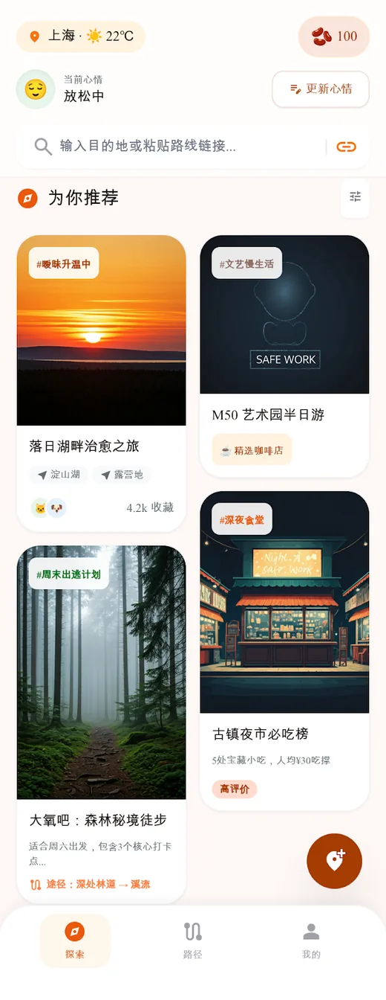
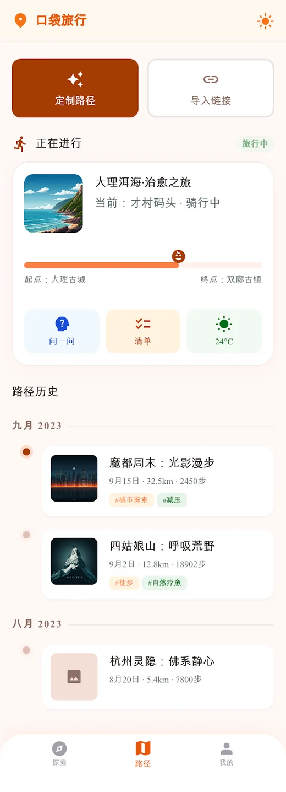
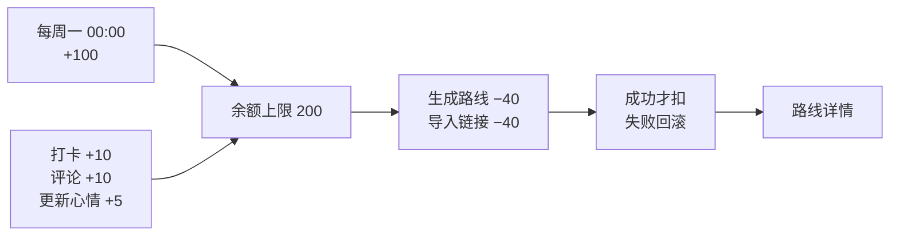
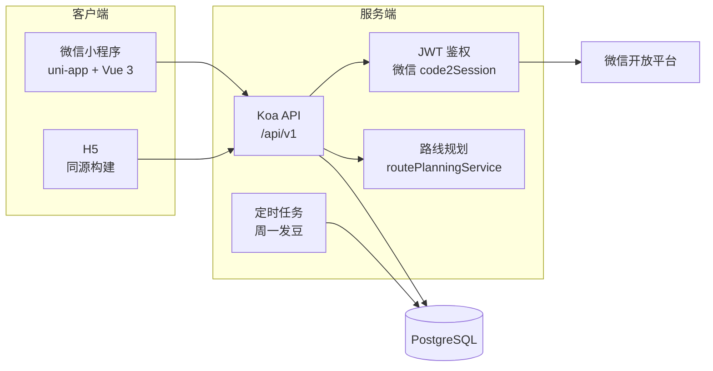

<div align="center">



# 🧸 口袋旅行搭子


**面向 18~35 岁的情绪疗愈型周末微旅行规划助手**

7 题情绪问答构建画像 → 消耗「豆子」生成可执行路线 → 现场打卡、写机位干货、分享海报赚回豆子

<sub>探索灵感 → 生成规划 → 现场打卡 → 分享赚豆</sub>

<br/>

[](https://uniapp.dcloud.net.cn/)
[](https://vuejs.org/)
[](https://www.typescriptlang.org/)
[](https://koajs.com/)
[](https://www.postgresql.org/)

[](#-质量门禁)
[](#-质量门禁)
[](#-死代码治理)
[](#-页面地图)
[](#-仓库体积)

<br/>





<sub>▲ 探索 / 路径 / 景点详情 —— 完整 HTML 原型见 <a href="docs/stitch_md/">docs/stitch_md/</a></sub>

</div>

---

## 💡 它解决什么问题

周末想出门，但不想花两小时翻攻略。心情是「想安静一下」，不是「想去某个景点」。
现有产品按热门度罗列景点，这个项目按**情绪与场景**匹配路线。

| 痛点 | 做法 |
|:---|:---|
| 🥱 攻略成本高 | 7 题情绪问答 → 直接产出可执行路线，含停留时长与衔接建议 |
| 🎭 推荐不贴心情 | 情绪标签 + 社交身份 + 天气共同决定场景类型（疗愈 / 社交 / 雨天 / 通用） |
| 📍 到了不知道干嘛 | 景点详情内置官方精选评论、机位干货、打卡与分享入口 |
| 💸 生成即扣费不放心 | **成功才扣豆**，失败回滚不扣；余额上限 200 防通胀 |
| 🧸 缺少仪式感 | NFC 玩偶靠近手机唤起小程序，直接落到路径页 |

---

## ✨ 核心功能

| 模块 | 能力 | 关键实现 |
|:---|:---|:---|
| 🧠 情绪画像 | 7 题问卷 → 标签 + 社交身份 + 出行节奏 | `pages/mood-qa` · `POST /api/v1/mood-map/submit` |
| 🗺 路线生成 | 情绪 + 城市 + 天数 + 氛围 → 途经点与衔接建议 | `utils/routePlanningService.js` |
| 🔗 链接导入 | 小红书 / 抖音 / 公众号链接解析成路线 | `POST /api/v1/routes/import-link` |
| 📍 现场打卡 | GPS ≤ 500 m 校验 + 照片 + 干货标签 | `utils/gps.js` · `pages/checkin-photo` |
| 💬 同频评论 | 按情绪画像排序，官方精选置顶 | `spotModel.getComments()` |
| 🫘 豆子经济 | 生成扣 40、打卡/评论 +10、周一发 100 | `bean-rule.ts` ↔ `beanRule.js` |
| 🖼 分享海报 | 路线/景点海报 + 12 位分享码回查 | `shareController` · `pages/share-generate` |
| 🔐 鉴权 | 微信 code2Session + JWT，10002 静默重登重试 | `utils/jwt.js` · `utils/request.ts` |

---

## 🚀 快速开始

### 环境要求

| 依赖 | 版本 | 说明 |
|:---|:---|:---|
| Node.js | ≥ 20 | 前端与后端共用 |
| npm | ≥ 10 | 仓库使用 `package-lock.json` |
| PostgreSQL | ≥ 14 | 仅后端需要；缺失时可降级启动 |
| 微信开发者工具 | 最新稳定版 | 仅 `mp-weixin` 端需要 |

### 1️⃣ 前端

```bash
npm install

npm run dev:mp-weixin     # 产物 dist/dev/mp-weixin，用微信开发者工具导入
npm run dev:h5            # 浏览器调试 → http://localhost:5173
```

### 2️⃣ 后端

```bash
cd backend-api
npm install
cp .env.example .env      # 按需修改数据库与 JWT 配置
npm run dev               # nodemon → http://127.0.0.1:3000
```

<details>
<summary><b>📋 .env 关键项（点开）</b></summary>

```ini
NODE_ENV=development
PORT=3000
ALLOW_START_WITHOUT_DB=true   # 无数据库时降级启动，仅无 DB 依赖的接口可用

DB_HOST=127.0.0.1
DB_PORT=5432
DB_USER=postgres
DB_PASSWORD=
DB_NAME=pocket_travel_companion

JWT_SECRET=change-me-in-local-env   # 生产环境缺失会直接启动失败
JWT_EXPIRES_IN=7d
WECHAT_MOCK=true                    # 本地免真实微信登录
```

建表：把 `backend-api/src/models/schema.sql` 导入 `DB_NAME` 指向的库。

</details>

### 3️⃣ 联调

| 服务 | 地址 |
|:---|:---|
| 后端 API | http://127.0.0.1:3000 |
| Swagger UI | http://127.0.0.1:3000/docs |
| OpenAPI JSON | http://127.0.0.1:3000/openapi.json |
| 健康检查 | http://127.0.0.1:3000/health |
| 前端 H5 | http://localhost:5173 |

前端开发环境默认指向 `http://127.0.0.1:3000`（`src/config/env.ts`）。
生产地址由 `VITE_API_BASE_URL` 注入，仓库里不写真实服务器。

微信开发者工具里需勾选 **不校验合法域名**，否则 `127.0.0.1` 会被拦截。

---

## 🧩 最小可用示例

### 生成一条路线（前端）

```ts
import { generateRoute } from '@/api'
import { buildRouteGeneratePayload } from '@/pages/path/route-factory'
import { guardBeanCost } from '@/utils/bean-guard'
import { BEAN_RULE } from '@/utils/bean-rule'

// 余额不足会弹窗说明获取途径并返回 false，不会发请求
if (!guardBeanCost(balance, BEAN_RULE.routeGenerationCost, '生成路线')) return

const { routeId, remainingBeans } = await generateRoute(
  buildRouteGeneratePayload(
    { city: '上海', dayMode: 'one_day', spotPreferences: ['咖啡', '自然'] },
    moodTags
  )
)
```

### 同一个接口（curl）

```bash
TOKEN="<登录后拿到的 JWT>"

curl -X POST http://127.0.0.1:3000/api/v1/routes/generate \
  -H "Authorization: Bearer $TOKEN" \
  -H "Content-Type: application/json" \
  -d '{
    "city": "上海",
    "dayMode": "one-day",
    "spotPreferences": ["咖啡", "自然"],
    "moodTags": ["安静", "疲惫"]
  }'
```

```json
{
  "code": 0,
  "message": "ok",
  "data": { "routeId": 42, "consumedBeans": 40, "remainingBeans": 60 }
}
```

> 失败时 `code` 非 0，且**不扣豆**。扣费与路线写入在同一个事务里，任一步失败整体回滚。

---

## 🫘 豆子经济

前后端各有一份规则常量，必须同步修改：
`src/utils/bean-rule.ts` ↔ `backend-api/src/utils/beanRule.js`



| 事件 | 变动 | 约束 |
|:---|:---:|:---|
| 生成路线 | −40 | 成功才扣；失败回滚 |
| 导入自媒体链接生成 | −40 | 同上 |
| 景点打卡 | +10 | 每景点每日一次；GPS ≤ 500 m |
| 发表评论 | +10 | 每景点每日一次 |
| 更新情绪画像 | +5 | 每日一次（幂等 claim） |
| 每周一 00:00 系统发放 | +100 | 每人每周一次（幂等 claim） |
| 余额上限 | — | 200，超出部分截断 |

幂等靠 `bean_reward_claims` 的唯一键
`(user_id, reward_type, target_type, target_id, reward_date)` 保证，并发下不会重复发放。

---

## 🏗 架构



**后端分层**：`routes`（路径映射）→ `controllers`（业务编排、事务边界）→ `models`（SQL）→ `utils`（纯函数）

两条硬约定：

- 事务只走 `utils/transaction.js` 的 `withTransaction()`，不手写 `getConnection / begin / commit / rollback / release`
- JSON 列只走 `utils/json.js`，`parseJson` 读、`stringifyJson*` 写，null 语义由函数名区分

---

## 📁 目录结构

```
口袋旅行搭子/
├── src/                        # 前端（uni-app 输入目录）
│   ├── api/index.ts            # 所有后端接口的唯一入口
│   ├── pages/                  # 14 个页面，样式就近写在 .vue 内
│   │   └── path/route-factory.ts   # 表单 → 接口 payload 的纯函数
│   ├── store/                  # Pinia：user / bean / route
│   ├── utils/                  # request / auth / session / feedback / bean-rule / gps / mood-map
│   ├── styles/                 # 全局变量、mixins、组件样式
│   ├── pages.json              # 页面注册与 tabBar
│   └── manifest.json           # 小程序 appid 与权限
├── backend-api/
│   ├── src/
│   │   ├── routes/             # 路由表
│   │   ├── controllers/        # 业务编排
│   │   ├── models/             # SQL 与 schema.sql
│   │   └── utils/              # transaction / json / jwt / gps / beanRule
│   ├── docs/openapi.json       # OpenAPI 3 描述
│   └── tests/                  # Vitest + mock DB
├── tests/                      # 前端 Vitest：业务规则、页面契约、API 层
├── scripts/quality/            # PRD 74 条验收覆盖矩阵
├── docs/                       # PRD、API、架构、设计稿
└── openspec/                   # 需求覆盖审计变更规格
```

> 根目录**没有** `pages.json` / `manifest.json`。uni-app 的 vite 插件以 `src/` 为输入目录，
> 根目录副本从未被读取，已在清理中移除。

完整放置规则见 **[docs/architecture.md](docs/architecture.md)**。

---

## 🗺 页面地图

<details open>
<summary><b>14 个页面</b></summary>

| # | 页面 | 路径 | 职责 |
|---:|:---|:---|:---|
| 1 | 加载动画 | `pages/loading/loading` | NFC 唤起后的过渡与仪式感 |
| 2 | 情绪问卷 | `pages/mood-qa/mood-qa` | 7 题画像，提交后 +5 豆 |
| 3 | 标签设置 | `pages/tag-setting/tag-setting` | 兴趣标签，影响推荐与路线 |
| 4 | 探索 | `pages/explore/explore` | 定位/天气/豆子余额 + 推荐瀑布流 |
| 5 | 路径 | `pages/path/path` | 生成路线、导入链接、历史行程 |
| 6 | 路线预览 | `pages/route-preview/route-preview` | 只读预览，显式采纳才扣豆 |
| 7 | 路线详情 | `pages/route-detail/route-detail` | 途经点、衔接建议、地图导航 |
| 8 | 景点详情 | `pages/spot-detail/spot-detail` | 官方精选评论、打卡、点赞、分享 |
| 9 | 打卡拍照 | `pages/checkin-photo/checkin-photo` | GPS 校验 + 上传 + 干货标签 |
| 10 | 全部评论 | `pages/comments-all/comments-all` | 同频评论排序与点赞 |
| 11 | 豆子明细 | `pages/bean-log/bean-log` | 收支流水与规则说明 |
| 12 | 互动消息 | `pages/message/message` | 点赞/评论通知 |
| 13 | 分享图生成 | `pages/share-generate/share-generate` | 路线/景点海报与分享码 |
| 14 | 我的 | `pages/profile/profile` | 资产、画像、快捷入口 |

底部 tabBar 三项：探索 / 路径 / 我的。

</details>

---

## ✅ 质量门禁

```bash
npm run lint && npm run type-check && npm run test:coverage && npm run deadcode:check
```

| 检查 | 命令 | 当前状态 |
|:---|:---|:---|
| 前端单测 | `npm run test` | **9 文件 / 50 用例** 通过 |
| 前端覆盖率 | `npm run test:coverage` | **100%** statements / branches / functions / lines |
| 类型检查 | `npm run type-check` | 0 error |
| 代码规范 | `npm run lint` | 0 error |
| 死代码 | `npm run deadcode:check` | knip clean |
| 小程序构建 | `npm run build:mp-weixin` | 通过，14 页注册 |
| 后端单测 | `cd backend-api && npm run test` | **6 文件 / 35 用例** 通过 |
| 后端覆盖率 | `cd backend-api && npm run test:coverage` | 82.0 / 71.1 / 88.5 / 83.1（阈值 80/70/85/81） |
| 需求覆盖矩阵 | `npm run validate:coverage-matrix` | 74 条验收标准，输出 `bugs.csv` |

> 后端测试需 `NODE_ENV=test`。若 shell 里已导出 `NODE_ENV=production`，
> `grantWeeklyBeansBatch` 的幂等分支会走生产路径导致用例失败 —— 这是环境变量问题，不是代码问题。

---

## 🧠 代码约定

七条硬规则，违反任何一条都会在 review 里被指出来：

| # | 规则 | 为什么 |
|:---:|:---|:---|
| 1 | **接口只从 `src/api/` 出** | 页面不拼 `/api/v1/...` 字符串，路径与响应类型只维护一份 |
| 2 | **反馈只从 `src/utils/feedback.ts` 出** | `errorMessage` / `toastError` / `toastSuccess` / `toastInfo`，图标与文案提取规则统一 |
| 3 | **会话守卫只从 `src/utils/session.ts` 出** | `ensureSession()` 负责 token 缺失/过期时的静默重登 |
| 4 | **业务数字只从常量出** | 豆子走 `BEAN_RULE`，GPS 走 `GPS_RADIUS_METER`，心情刷新走 `MOOD_REFRESH_DAYS`；模板文案也走插值 |
| 5 | **事务只走 `withTransaction`** | 手写 `release()` 漏一次就耗尽连接池 |
| 6 | **JSON 列只走 `utils/json.js`** | 5 份 `toJson` 复制过，null 语义只差一个分支，改错不报错只丢数据 |
| 7 | **页面样式就近** | 写在 `.vue` 的 `<style scoped>` 或页面同目录 `*.scss`，没有集中式页面样式目录 |

**判断标准**：同一个逻辑出现第二次，就必须抽出去。第一次可以就地写。

---

## 🧹 死代码治理

```bash
npm run deadcode:check    # knip，CI 里跑这个
npm run deadcode:report   # 输出 JSON 到 deadcode-report.json
```

配置在 `knip.json`，两个 workspace：根（前端）与 `backend-api`。

**uni-app 的坑**：页面通过 `src/pages.json` 的**字符串路径**注册，不是 import。
knip 跟不到这种引用，所以 `src/pages/**/*.vue` 必须显式列进 `entry`，否则 14 个页面全报孤儿。

**两个不能删的「未使用」依赖**：

| 依赖 | 为什么保留 |
|:---|:---|
| `koa-static` | `swagger-ui-koa` 运行时 `require` 它，删了 `node src/app.js` 直接 MODULE_NOT_FOUND |
| `@vue/compiler-sfc` | SFC 编译链依赖，`vue-tsc` 与 vite 插件间接使用 |

删除流程与已知盲区见 **[docs/architecture.md](docs/architecture.md#3-死代码治理)**。

---

## 📦 仓库体积

从 27 MB 瘦到 **1.8 MB**（177 个文件），做法是「能重新生成的、含隐私的、纯本地的都不进仓库」：

| 处理 | 内容 |
|:---|:---|
| 🗑 删除 | 根目录重复的 `pages.json`/`manifest.json`、死样式树 `styles/pages/**`、占位页 `me.vue`、36 个 `.gitkeep`、`Poster.svg`（19.6 MB）、13 张零引用设计稿 PNG |
| 📦 归档后删除 | 未接入代码的 `ui-assets/` 切图 |
| 🖼 重编码 | README 首屏 3 张图 1600px PNG → 520px WebP（1.25 MB → 168 KB） |
| 🚫 忽略 | `node_modules` `dist` `coverage` `.env` 证书私钥 数据库导出 `bugs.csv` |

`.gitignore` 按「泄露后果」排序，证书/私钥/数据库导出单独成组。
验证命令：`git ls-files -ci --exclude-standard` 必须输出为空。

---

## 🚧 已知缺口

| 项 | 现状 | 下一步 |
|:---|:---|:---|
| 路线生成 | `routePlanningService` 为确定性规则 + 模拟数据 | 接真实 POI 与 RAG 检索 |
| 地图服务 | 未实现 | 新建 `utils/mapService.js` 接高德/腾讯地图 API |
| RAG 检索 | 未实现 | 新建 `utils/ragService.js` 接向量库（pgvector / Milvus） |
| 微信登录 | `WECHAT_MOCK=true` 时跳过 code2Session | 配置真实 appid/secret |
| 分享海报 | 返回 CDN 占位 URL | 接真实海报渲染与小程序码 |
| 页面级测试 | 以源码契约测试为主 | 引入 `@vue/test-utils` 做组件挂载测试 |

完整待办见 `bugs.csv`（由覆盖矩阵生成）与 `openspec/changes/`。

---

## 🤝 参与贡献

```bash
git checkout -b feature/your-feature

# 改完先自检
npm run lint && npm run type-check && npm run test:coverage && npm run deadcode:check
cd backend-api && npm run lint && NODE_ENV=test npm run test
```

提交信息遵循 `feat:` / `fix:` / `docs:` / `chore:` / `refactor:` / `test:`。
分支策略与 PR 流程见 [CONTRIBUTING.md](CONTRIBUTING.md)。

**改代码前请先读**：

- [`docs/architecture.md`](docs/architecture.md) —— 目录规范、放置规则、死代码治理
- [`.context/prefs/coding-style.md`](.context/prefs/coding-style.md) —— 编码规范
- [`.context/prefs/workflow.md`](.context/prefs/workflow.md) —— 工作流与决策记录规则
- [`CLAUDE.md`](CLAUDE.md) —— 项目上下文与模块索引

---

## 📚 文档索引

| 文档 | 内容 |
|:---|:---|
| [`PRD_V1.0.md`](PRD_V1.0.md) | 产品需求文档（唯一权威版本） |
| [`docs/architecture.md`](docs/architecture.md) | 目录规范、放置规则、死代码治理 |
| [`docs/API.md`](docs/API.md) | 接口说明与业务规则对齐 |
| [`backend-api/docs/openapi.json`](backend-api/docs/openapi.json) | OpenAPI 3 描述 |
| [`docs/stitch_md/`](docs/stitch_md/) | 16 页 HTML 原型（设计源）+ 3 张首屏截图 |
| [`docs/口袋旅行搭子 UI资源使用说明.md`](docs/口袋旅行搭子%20UI资源使用说明.md) | 设计规范与样式组织 |
| [`docs/PD_BUSINESS_PLAN.md`](docs/PD_BUSINESS_PLAN.md) | 商业计划书 |
| [`.dev.rule`](.dev.rule) | 业务规则强约束（豆子、GPS、NFC、分享） |

---

<div align="center">

**如果这个项目对你有帮助，点个 ⭐ 就是最好的鼓励**

<sub>Made with 🧡 for people who just want to get out of the house.</sub>

</div>

<!--
仓库公开后，把下面这段取消注释即可启用动态统计卡片：

<div align="center">

[](https://star-history.com/#<owner>/<repo>&Date)

/<repo>" alt="contributors" />

</div>

当前仓库对公开访问不可见，动态徽章会 404，所以先注释掉。
-->
